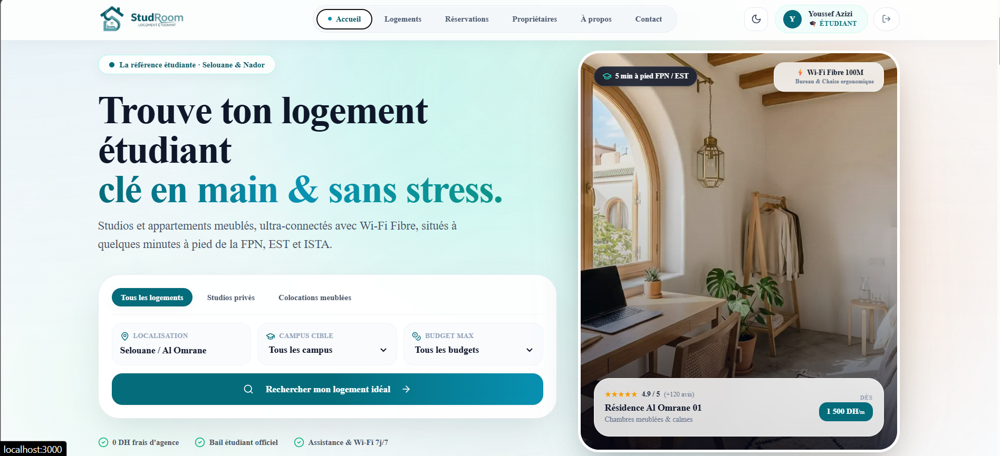

# StudRoom — Plateforme de Logement Étudiant à Selouane / Nador

<p align="center">
  
</p>

<p align="center">
  <strong>Le logement étudiant clé en main, moderne et connecté au cœur du campus de Selouane & Nador.</strong>
</p>

<p align="center">
  <a href="https://nextjs.org/"></a>
  <a href="https://expressjs.com/"></a>
  <a href="https://www.typescriptlang.org/"></a>
  <a href="https://tailwindcss.com/"></a>
  <a href="https://supabase.com/"></a>
  <a href="#-s%C3%A9curit%C3%A9--durcissement-syst%C3%A8me"></a>
</p>

---

## 📸 Aperçu de l'Interface Utilisateur (UI Showcase)

<p align="center">
  
</p>

*Interface moderne et épurée optimisée pour les étudiants et propriétaires à Selouane & Nador (Desktop & Mobile).*

---

## ✨ Fonctionnalités Clés

- 🎓 **Focalisation Campus Selouane** : Logements vérifiés à 3–5 minutes à pied de la **Faculté Pluridisciplinaire de Nador (FPN)** et de l'**École Supérieure de Technologie (EST Nador)**.
- 🌓 **Mode Sombre / Mode Clair** : Bascule de thème instantanée avec mémorisation des préférences utilisateur (`localStorage` + détection système OS).
- 📲 **Intégration WhatsApp & Gmail Directe** :
  - Discussion WhatsApp instantanée avec message pré-rempli (`+212 634 536 286`).
  - Boutons de copie rapide du numéro et de l'email officiel (`studroom50@gmail.com`).
  - Raccourci rapide intégré au formulaire de contact pour les demandes urgentes.
- 📋 **Formulaire de Réservation Sans Friction** : Demande de réservation complète avec validation Zod en temps réel, choix de la chambre, durée et date d'arrivée souhaitée.
- 🤝 **Espace Propriétaires Dédié** : Dépôt et gestion de propositions de logements pour les bailleurs de Selouane et Nador.
- ❓ **FAQ Interactive & Recherchable** : Système d'accordéon dynamique classé par thématiques (Visites, Dossier & Bourse, Tarifs & Caution, Emplacement & Sécurité) avec barre de recherche instantanée.
- 🔐 **Authentification Robuste** : Inscription/Connexion par identifiants ou via **Google OAuth** avec vérification cryptographique des tokens côté serveur.

---

## 🎨 Identité Visuelle & Thème

- **Couleur Primaire** : **Bleu Canard Signature** (`#046c7a` / `#0891b2`)
- **Couleur d'Accent** : Ambre chaleureux & Émeraude réassurance
- **Typographie** : *Plus Jakarta Sans* (moderne, lisible, premium)
- **Logos & Médias** :
  - Logo Principal : [`public/images/logo_studroom.png`](public/images/logo_studroom.png)
  - Icône WhatsApp Officielle : [`public/images/watsapp_icon.jpeg`](public/images/watsapp_icon.jpeg)
  - Icône Gmail Officielle : [`public/images/gmail_icon.jpeg`](public/images/gmail_icon.jpeg)
  - Icône Localisation : [`public/images/local_icon.jpeg`](public/images/local_icon.jpeg)

---

## 📞 Coordonnées Officielles

- 📱 **WhatsApp & Téléphone** : `+212 634 536 286`
- ✉️ **Adresse Email** : `studroom50@gmail.com`
- 📍 **Bureau d'Accueil** : Secteur 3, Résidence Al Omrane, Selouane, Nador, Maroc
- 🕒 **Horaires d'Ouverture** : Lundi – Samedi : 09h00 – 19h00 (Visites 7j/7 sur rendez-vous)

---

## 🏗️ Architecture du Monorepo

Le projet adopte une **architecture découplée** assurant une séparation étanche entre le client web et l'API métier :

```text
StudRoom/
├── src/                          # 🌐 FRONTEND (Next.js 14 App Router)
│   ├── app/                      # Pages de l'application
│   │   ├── page.tsx              # Page d'accueil (Hero, Avantages, Logements)
│   │   ├── contact/page.tsx      # Page Contact (WhatsApp, Gmail, Bureau, FAQ)
│   │   ├── reservations/         # Tunnel de réservation de chambres
│   │   ├── proprietaires/        # Espace bailleurs & propriétaires
│   │   ├── a-propos/             # Présentation de l'équipe et mission
│   │   └── auth/callback/        # Callback sécurisé OAuth Google Supabase
│   ├── client/services/          # Couche HTTP centralisée (ApiClient)
│   ├── components/               # Composants réutilisables
│   │   ├── forms/                # Formulaires validés (Booking, Contact, Landlord)
│   │   ├── home/                 # Sections Accueil (Hero, Benefits, Universités)
│   │   ├── layout/               # Header avec Toggle Dark/Light, Footer
│   │   └── ui/                   # Composants UI atomiques (Button, Input, Select)
│   ├── context/                  # AuthContext, ThemeContext
│   ├── data/                     # Données de catalogue & résidences Selouane
│   └── shared/                   # Schémas de validation Zod et Types TypeScript partagés
│
├── backend/                      # ⚙️ BACKEND (Node.js / Express / TypeScript)
│   ├── src/
│   │   ├── config/               # Variables d'environnement & CORS strict
│   │   ├── controllers/          # Contrôleurs HTTP REST API
│   │   ├── services/             # Logique métier & Vérification de tokens OAuth
│   │   ├── repositories/         # Couche d'accès aux données (Supabase / In-Memory Fallback)
│   │   ├── routes/               # Endpoints REST Versionnés (/api/v1/...)
│   │   ├── middleware/           # Auth JWT, Rate Limiting, Validation Zod, Error Handler
│   │   └── server.ts             # Serveur Express durci
│   └── sql/                      # Schéma PostgreSQL avec Row Level Security (RLS)
│       └── schema.sql
│
├── public/                       # 🖼️ Assets statiques (Logos, Photos, Icônes)
├── docs/                         # Documentation API & Guides
├── next.config.mjs               # Configuration Next.js avec En-têtes HTTP de Sécurité
├── package.json                  # Orchestration Monorepo (concurrently)
└── README.md
```

---

## 🚀 Installation & Démarrage

### 1. Prérequis
- **Node.js** v18.17+ ou v20+
- **npm** v9+

### 2. Installation des Dépendances

```bash
# À la racine du projet
npm install

# Dans le sous-dossier backend
cd backend && npm install && cd ..
```

---

### 3. Variables d'Environnement

Créez vos fichiers de configuration locale :

**Frontend (`.env.local`) :**
```env
NEXT_PUBLIC_API_URL=http://localhost:4000/api/v1
NEXT_PUBLIC_SUPABASE_URL=https://votre-projet.supabase.co
NEXT_PUBLIC_SUPABASE_ANON_KEY=votre_cle_anon_publique
```

**Backend (`backend/.env`) :**
```env
NODE_ENV=development
PORT=4000
FRONTEND_URL=http://localhost:3000
JWT_SECRET=votre_cle_secrete_aleatoire_64_bits
JWT_EXPIRES_IN=7d
SUPABASE_URL=https://votre-projet.supabase.co
SUPABASE_ANON_KEY=votre_cle_anon
SUPABASE_SERVICE_ROLE_KEY=votre_cle_service_role_privee
```

---

### 4. Lancement en Mode Développement

Lancez simultanément le **Frontend Next.js** et le **Backend Express** avec une seule commande :

```bash
npm run dev
```

- 🟢 **Frontend Next.js** : [http://localhost:3000](http://localhost:3000)
- 🔵 **Backend Express API** : [http://localhost:4000/api/v1/health](http://localhost:4000/api/v1/health)

#### Commandes individuelles :
```bash
# Lancer uniquement le frontend Next.js
npm run dev:frontend

# Lancer uniquement le backend Express
npm run dev:backend
```

---

## 🔒 Sécurité & Durcissement Système

La plateforme a fait l'objet d'un audit et d'un durcissement de sécurité complet :

1. **Vérification Cryptographique OAuth** :
   - Le backend valide systématiquement le jeton d'accès Supabase (`session.access_token`) côté serveur avant d'émettre une session JWT, empêchant toute usurpation d'identité.
2. **Row Level Security (RLS) PostgreSQL** :
   - Politiques d'isolation actives sur toutes les tables (`users`, `booking_requests`, `landlord_submissions`, etc.). Les étudiants ne peuvent lire que leur propre profil et les requêtes publiques sont confinées.
3. **Protection Anti-Brute Force (Rate Limiting)** :
   - `authLimiter` strict configuré sur `/api/v1/auth/login`, `/register` et `/google` (maximum 10 tentatives / 15 minutes par IP).
4. **En-têtes HTTP de Sécurité (OWASP)** :
   - `X-Frame-Options: DENY` (anti-clickjacking).
   - `X-Content-Type-Options: nosniff` (anti-MIME sniffing).
   - `Referrer-Policy: strict-origin-when-cross-origin`.
   - `Permissions-Policy: camera=(), microphone=(), geolocation=()`.
5. **Validation Stricte des Données** :
   - Tous les flux entrants sont assainis via des schémas **Zod** stricts côté client et serveur.
   - Politique de mot de passe renforcée (minimum 8 caractères avec au moins une lettre et un chiffre).

---

## 📡 Principaux Endpoints de l'API REST v1

Consultez [docs/API.md](docs/API.md) pour la documentation exhaustive.

| Méthode | Endpoint | Accès | Description |
|---|---|---|---|
| `GET` | `/api/v1/health` | Public | Vérification de l'état du serveur |
| `POST` | `/api/v1/auth/login` | Public (Rate-Limited) | Connexion utilisateur (JWT) |
| `POST` | `/api/v1/auth/register` | Public (Rate-Limited) | Inscription nouvel utilisateur |
| `POST` | `/api/v1/auth/google` | Public (Token-Verified) | Authentification OAuth sécurisée |
| `GET` | `/api/v1/auth/me` | Authentifié | Profil de l'utilisateur connecté |
| `GET` | `/api/v1/properties` | Public | Liste des logements avec filtres |
| `GET` | `/api/v1/properties/:slug` | Public | Fiche détaillée d'un logement |
| `GET` | `/api/v1/rooms` | Public | Recherche de chambres individuelles |
| `POST` | `/api/v1/booking-requests` | Public | Soumission d'une réservation |
| `GET` | `/api/v1/booking-requests` | **Admin** | Consultation des demandes |
| `POST` | `/api/v1/landlord-properties` | Public | Proposition de logement bailleur |
| `POST` | `/api/v1/contact` | Public | Envoi d'un message support |

---

## 🛠️ Build de Production

```bash
# Compiler à la fois le frontend et le backend
npm run build

# Démarrer en production
npm run start
```

---

## 📄 Licence & Mentions Légales

© 2026 **StudRoom Maroc**. Tous droits réservés.  
*La plateforme de référence pour le logement étudiant à Selouane & Nador.*
