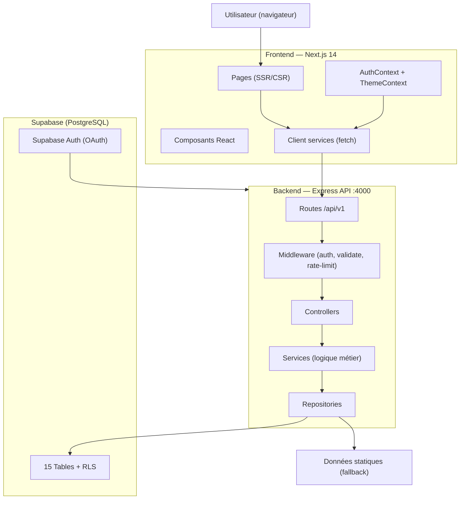

# 🏠 Analyse Complète — StudRoom

> Plateforme de logement étudiant ciblant Selouane / Nador (Maroc)  
> Domaine cible : **studroom.ma** · Analyse réalisée le 09/09/2026

---

## 1. Vue d'ensemble du projet

**StudRoom** est une plateforme web fullstack de mise en relation entre étudiants et propriétaires de logements dans la région de Selouane / Nador au Maroc. Elle cible principalement les étudiants des établissements FPN (Faculté Pluridisciplinaire de Nador), EST Nador et ISTA Selouane.

### Stack technologique

| Couche | Technologie |
|--------|-------------|
| **Frontend** | Next.js 14 (App Router), React 18, TypeScript 5.6 |
| **CSS** | Tailwind CSS 3.4, Plus Jakarta Sans (Google Fonts) |
| **Backend** | Node.js + Express 4, TypeScript |
| **Base de données** | Supabase (PostgreSQL) + RLS |
| **Auth** | JWT (bcryptjs) + Supabase OAuth (Google) |
| **Validation** | Zod (partagé frontend/backend) |
| **Forms** | React Hook Form + @hookform/resolvers |
| **Icônes** | Lucide React |
| **Sécurité** | Helmet, CORS, express-rate-limit |

---

## 2. Architecture générale

```
StudRoom/
├── src/                          ← Frontend Next.js (App Router)
│   ├── app/                      ← Routes & pages
│   │   ├── page.tsx              ← Page d'accueil (SSR)
│   │   ├── logements/            ← Liste des logements + [slug]
│   │   ├── dashboard/            ← Admin dashboard (Client)
│   │   ├── auth/                 ← Auth callback (OAuth)
│   │   ├── reservations/         ← Flow de réservation
│   │   ├── proprietaires/        ← Page propriétaires
│   │   ├── contact/              ← Formulaire contact
│   │   ├── connexion/            ← Page connexion
│   │   ├── inscription/          ← Page inscription
│   │   ├── a-propos/             ← Page à propos
│   │   ├── comment-ca-marche/    ← Explication du flow
│   │   ├── robots.ts             ← SEO: robots.txt
│   │   └── sitemap.ts            ← SEO: sitemap.xml
│   ├── components/               ← Composants React réutilisables
│   │   ├── layout/               ← Header, Footer
│   │   ├── home/                 ← HeroSection, BenefitsSection, FeaturedProperties…
│   │   ├── properties/           ← Cards, filtres, détail logement
│   │   ├── forms/                ← AuthModal, formulaires
│   │   ├── ui/                   ← Button, Input, composants primitifs
│   │   └── auth/                 ← Composants d'authentification
│   ├── context/                  ← React Context (Auth + Theme)
│   ├── client/services/          ← Services API côté client (fetch wrapper)
│   ├── data/                     ← Données statiques de fallback (properties, cities…)
│   ├── shared/types/             ← Types TypeScript partagés frontend
│   └── lib/                      ← Utilitaires (supabase client, helpers)
│
└── backend/                      ← API REST Express
    ├── src/
    │   ├── server.ts             ← Point d'entrée Express
    │   ├── config/               ← env, cors, supabase
    │   ├── routes/               ← Routeurs Express par domaine
    │   ├── controllers/          ← Couche HTTP (req/res)
    │   ├── services/             ← Logique métier
    │   ├── repositories/         ← Accès données (Supabase + fallback statique)
    │   ├── middleware/            ← auth, validate, error, not-found
    │   └── shared/               ← Schemas Zod + Types TypeScript
    └── sql/
        └── schema.sql            ← Schéma PostgreSQL complet avec RLS
```

---

## 3. Base de données (PostgreSQL / Supabase)

### Tables principales (15 tables)

| # | Table | Rôle |
|---|-------|------|
| 1 | `cities` | Villes actives (slug, region, pays) |
| 2 | `universities` | Établissements avec coordonnées GPS |
| 3 | `users` | Comptes (student / landlord / admin) + password_hash |
| 4 | `students` | Profil étudiant étendu (filière, niveau, date souhaitée) |
| 5 | `landlords` | Profil propriétaire (entreprise, taxe) |
| 6 | `properties` | Logements (type, prix, surface, status, geoloc) |
| 7 | `rooms` | **Unité réservable centrale** (chambre/studio/shared) |
| 8 | `amenities` | Équipements catalogue (catégorisés) |
| 9 | `property_amenities` | Junction logement ↔ équipements |
| 10 | `room_amenities` | Junction chambre ↔ équipements |
| 11 | `property_images` | Galerie photos des logements |
| 12 | `university_proximities` | Distance propriété ↔ université |
| 13 | `booking_requests` | Demandes de réservation étudiants |
| 14 | `contact_requests` | Formulaires de contact |
| 15 | `landlord_submissions` | Propositions de propriétaires |

### Statuts des propriétés
`DRAFT` → `UNDER_REVIEW` → `AVAILABLE` → `PARTIALLY_OCCUPIED` → `FULLY_OCCUPIED` → `UNAVAILABLE`

### Statuts des chambres
`AVAILABLE` | `RESERVED` | `OCCUPIED` | `MAINTENANCE` | `UNAVAILABLE`

### Statuts des réservations
`PENDING` → `CONTACTED` → `VISIT_SCHEDULED` → `APPROVED` / `REJECTED` / `CANCELLED`

### Sécurité RLS (Row Level Security)
- ✅ RLS activé sur toutes les tables
- ✅ Public : lecture seule sur properties/rooms/cities/universities disponibles
- ✅ Utilisateurs : accès uniquement à leur propre profil
- ✅ Service role (backend) : accès total pour les opérations CRUD
- ✅ Booking/Contact : INSERT public, lecture réservée au service role

---

## 4. API REST Backend (`/api/v1`)

### Endpoints

| Méthode | Route | Auth | Description |
|---------|-------|------|-------------|
| `GET` | `/health` | Public | Health check |
| `POST` | `/auth/login` | Public | Connexion email/mot de passe |
| `POST` | `/auth/register` | Public | Inscription |
| `POST` | `/auth/google` + `/auth/oauth` | Public | OAuth Google via Supabase |
| `GET` | `/auth/me` | JWT | Profil utilisateur connecté |
| `GET` | `/properties` | Public | Liste + filtres |
| `GET` | `/properties/featured` | Public | Logements mis en avant |
| `GET` | `/properties/:slug` | Public | Détail d'un logement |
| `GET` | `/rooms` | Public | Liste des chambres |
| `GET` | `/rooms/:id` | Public | Détail d'une chambre |
| `POST` | `/booking-requests` | Public | Créer une demande de réservation |
| `GET` | `/booking-requests` | **Admin** | Lister toutes les réservations |
| `PATCH` | `/booking-requests/:id/status` | **Admin** | Mettre à jour le statut |
| `POST` | `/landlord-properties` | Public | Proposer un logement |
| `GET` | `/landlord-properties` | **Admin** | Lister les propositions |
| `PATCH` | `/landlord-properties/:id/status` | **Admin** | Mettre à jour le statut |
| `POST` | `/contact` | Public | Envoyer un message de contact |
| `GET` | `/contact` | **Admin** | Lister les messages |
| `GET` | `/cities` | Public | Liste des villes |
| `GET` | `/universities` | Public | Liste des universités |
| `GET` | `/amenities` | Public | Catalogue des équipements |

### Sécurité API
- **Helmet** : headers HTTP sécurisés
- **CORS** configuré avec liste blanche d'origines
- **Rate limiting** à 3 niveaux :
  - Global : 200 req / 15 min
  - Mutations (booking, contact, landlord) : 30 req / 15 min
  - Auth (login, register, google) : **10 req / 15 min** (anti brute-force)
- **JWT** avec expiration 7 jours
- **Zod** validation serveur sur tous les endpoints d'écriture
- **bcryptjs** salt=10 pour les mots de passe

---

## 5. Authentification

### Flux d'authentification

```
Email/Password → POST /auth/login → JWT 7j → localStorage
                                               ↓
                                          AuthContext
                                               ↓
                                    Re-validation en background (/auth/me)
                                    Si invalide → logout automatique

Google OAuth → Supabase signInWithOAuth → /auth/callback → POST /auth/google
            → Vérification cryptographique du token Supabase côté backend
            → JWT 7j → setSession() → localStorage
```

### Rôles
| Rôle | Accès |
|------|-------|
| `student` | Consultation, réservation |
| `landlord` | Gestion de ses logements |
| `admin` | Dashboard complet, gestion de tous les flux |

### Points forts
- Token validé côté serveur à chaque requête protégée
- OAuth : vérification cryptographique obligatoire en production
- Logout propre : supprime localStorage + signOut Supabase
- Session persistée avec re-validation en arrière-plan

---

## 6. Frontend — Pages & Composants

### Pages principales
| Route | Type | Description |
|-------|------|-------------|
| `/` | SSR | Page d'accueil avec propriétés vedettes + universités |
| `/logements` | CSR | Catalogue avec filtres (ville, université, prix, type) |
| `/logements/[slug]` | SSR/ISR | Détail d'un logement avec chambres |
| `/reservations` | CSR | Flow de réservation d'une chambre |
| `/dashboard` | CSR + Auth Admin | Dashboard admin (réservations, propositions, contacts) |
| `/proprietaires` | CSR | Landing page + formulaire propriétaires |
| `/contact` | CSR | Formulaire de contact |
| `/connexion` | CSR | Formulaire de connexion |
| `/inscription` | CSR | Formulaire d'inscription |
| `/auth/callback` | CSR | Callback OAuth Google |
| `/comment-ca-marche` | SSG | Explication du processus |
| `/a-propos` | SSG | Page À propos |

### Composants Home
- `HeroSection` : Hero avec recherche par université
- `BenefitsSection` : Avantages de StudRoom
- `FeaturedProperties` : Grille des logements vedettes
- `HowItWorksPreview` : Résumé du processus en 3 étapes
- `LandlordBanner` : CTA pour les propriétaires
- `SupportedUniversitiesBanner` : Logos des universités partenaires

### Système de thème
- Modes `light` / `dark` / `system`
- Détection automatique au chargement (inline script sans flash)
- Persisté dans `localStorage` (`studroom-theme`)
- `ThemeProvider` via React Context

---

## 7. Gestion des données — Stratégie Hybride

Le projet utilise une **stratégie de fallback intelligente** :

```
Requête données
      ↓
Supabase disponible ?
      ↓ oui                    ↓ non / erreur
Données en base          Données statiques locales
   (production)              (src/data/*.ts)
```

Les fichiers `src/data/` et `backend/src/data/` contiennent des données de seed réalistes pour le développement et la démonstration :
- `properties.ts` : 3 propriétés avec chambres détaillées
- `cities.ts` : Villes du Maroc
- `universities.ts` : FPN, EST, ISTA Selouane
- `amenities.ts` : Équipements catalogués

---

## 8. SEO & Performance

### Points forts SEO
- ✅ `metadataBase` configuré sur `https://studroom.ma`
- ✅ Title et description optimisés pour mots-clés locaux
- ✅ Open Graph complet (image, locale `fr_MA`, type `website`)
- ✅ `robots.ts` et `sitemap.ts` générés dynamiquement
- ✅ Icônes (icon, shortcut, apple)
- ✅ Police web optimisée : `display: 'swap'`

### Performance
- Page d'accueil en **SSR** avec ISR (revalidate 60s pour properties, 3600s pour universités)
- `fetch()` natif Next.js avec cache intégré
- Scroll smooth activé globalement
- `antialiased` sur le body
- Pas de `console.log` en production

---

## 9. Points forts du projet

| Domaine | Force |
|---------|-------|
| **Architecture** | Clean Architecture (Controller → Service → Repository) bien respectée |
| **Sécurité** | Rate limiting multi-niveaux, RLS PostgreSQL, JWT, bcrypt |
| **TypeScript** | Types partagés entre frontend et backend via `shared/` |
| **Fallback** | Données statiques réalistes → site fonctionnel sans Supabase |
| **OAuth** | Vérification cryptographique du token Google en production |
| **SEO** | Sitemap, robots, OpenGraph, métadonnées locales |
| **UX** | Theme dark/light sans flash, modal auth intégrée |
| **Validation** | Zod partagé → cohérence garantie des schémas |
| **Localisation** | Messages d'erreur et interface entièrement en français |

---

## 10. Points à améliorer / Risques identifiés

### 🔴 Critique

1. **Session stockée uniquement dans `localStorage`**  
   - Vulnérable aux attaques XSS si du code tiers est injecté.  
   - *Recommandation* : Migrer vers des cookies `HttpOnly; Secure; SameSite=Strict`.

2. **Pagination non implémentée côté Supabase**  
   - La méthode `findAllProperties()` charge toutes les propriétés sans `limit/offset`.  
   - En production avec beaucoup de propriétés, cela va surcharger la mémoire.

3. **Booking ID non garanti unique**  
   - `'SR-BOOK-' + Math.floor(100000 + Math.random() * 900000)` — collision possible.  
   - *Recommandation* : Utiliser `uuid_generate_v4()` ou un counter DB.

### 🟡 Important

4. **Dashboard admin sans route guard solide côté client**  
   - Le composant `AccessDenied` côté client est cosmétique — un attaquant peut contourner.  
   - L'API est bien sécurisée mais l'UI devrait rediriger côté serveur.

5. **`findRooms()` dans le repository utilise toujours les données statiques**  
   - La méthode `findRooms()` n'utilise jamais Supabase, contrairement aux autres.  
   - Incohérence avec la stratégie hybride des autres méthodes.

6. **Pas de refresh token**  
   - JWT expire après 7 jours, aucun mécanisme de renouvellement automatique.

7. **Pas de gestion des images uploadées**  
   - Les images sont des URLs statiques en `/public/images/`.  
   - Pas de Supabase Storage pour l'upload dynamique.

### 🟢 Améliorations recommandées

8. **Tests automatisés absents** — Aucun test unitaire ni d'intégration détecté.

9. **Pas de notification email** — Les demandes de réservation/contact ne déclenchent pas d'emails (Resend, Nodemailer).

10. **Internationalisation (i18n) partielle** — Le site est en français mais il n'y a pas de système i18n formel pour l'arabe (langue locale importante).

11. **CRLF dans les fichiers backend** — Les fichiers `.ts` du backend contiennent des fins de ligne `\r\n` (Windows). Potentiellement problématique sur des serveurs Linux.

12. **Pas de monitoring / logging centralisé** — Morgan logs en développement, mais pas d'intégration avec un service comme Sentry ou Logtail en production.

---

## 11. Architecture résumée



---

## 12. Résumé exécutif

StudRoom est un projet **bien architecturé, propre et professionnel** pour une plateforme à taille moyenne. La séparation des couches (Controller / Service / Repository), l'usage de TypeScript strict, la validation Zod partagée et la sécurité en profondeur (RLS + JWT + rate limiting) témoignent d'une **bonne maturité technique**.

Le projet est en phase de développement / démo avec des données statiques réalistes. La priorité pour la mise en production serait de :

1. Migrer les tokens vers des cookies HttpOnly
2. Implémenter la pagination Supabase côté backend
3. Ajouter les notifications email (réservations, contact)
4. Mettre en place les tests automatisés
5. Corriger l'inconsistance de `findRooms()` pour utiliser Supabase
