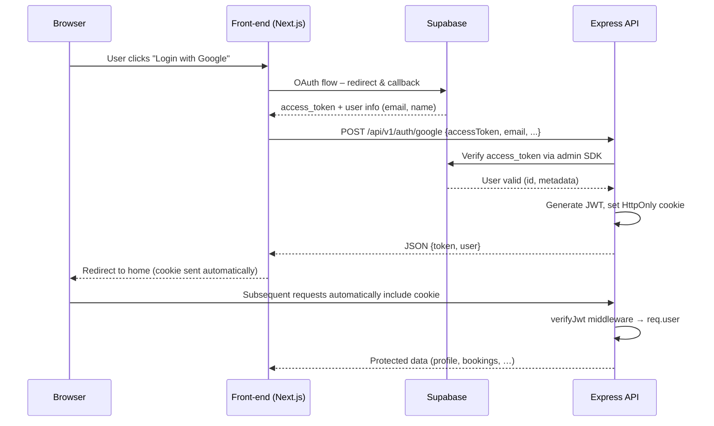

# 📊 Analyse Complète de l’Application **StudRoom**

---

## 1️⃣ Vue d’Ensemble

StudRoom est une plateforme monorepo qui regroupe :
- **Front‑end** : Next.js 14 (App Router) + TailwindCSS, React, TypeScript.
- **Back‑end** : Express + Node.js 18+, TypeScript, Supabase (PostgreSQL) comme source de données.
- **Auth** : OAuth Google via Supabase, puis validation cryptographique côté serveur avec JWT stocké dans un cookie HttpOnly.
- **Déploiement** : `npm run dev` lance les deux services en parallèle grâce à `concurrently`; `npm run build/start` pour la prod.

---

## 2️⃣ Architecture du Répertoire (extraits clés)

```
StudRoom/
├─ src/                     # 🎨 Front‑end (Next.js)
│  ├─ app/                 # Pages (App Router)
│  │  ├─ auth/callback/    # OAuth callback (page.tsx)
│  │  ├─ connexion/        # Login page
│  │  ├─ inscription/       # Sign‑up page
│  │  ├─ dashboard/         # Tableau de bord utilisateur
│  │  ├─ layout.tsx         # Root layout & Theme logic
│  │  └─ globals.css        # Styles globaux (Tailwind + custom)
│  ├─ components/          # Composants UI réutilisables
│  │  ├─ auth/              # Modals, forms liés à l’auth
│  │  ├─ home/              # Sections d’accueil (hero, avantages)
│  │  ├─ layout/            # Header / Footer
│  │  ├─ ui/                # Boutons, inputs, etc.
│  │  └─ forms/             # Formulaires Zod‑validés (booking, contact)
│  ├─ context/              # AuthContext, ThemeContext
│  ├─ data/                 # Données statiques (universités, listings)
│  └─ lib/                  # Wrapper Supabase client
├─ backend/                 # ⚙️ API Express
│  ├─ src/
│  │  ├─ config/            # env, CORS
│  │  ├─ controllers/       # auth.controller.ts, booking.controller.ts, etc.
│  │  ├─ services/          # logiques métier (auth.service.ts, booking.service.ts)
│  │  ├─ repositories/      # Accès aux données (Supabase, fallback)
│  │  ├─ middleware/        # JWT validation, rate‑limiting, Zod validation, error handling
│  │  ├─ routes/            # Définition des routes versionnées (/api/v1/...)
│  │  └─ server.ts          # Démarrage du serveur Express (hardened)
│  └─ sql/schema.sql        # Schéma PostgreSQL avec RLS
├─ public/                  # Images, logos, UI.png
├─ docs/                    # Documentation API
├─ next.config.mjs          # Headers de sécurité, image optimisation
├─ tailwind.config.ts       # Configuration Tailwind (dark mode, custom colors)
├─ package.json             # Scripts, dépendances communes
└─ README.md                # Présentation, installation, badges
```
---

## 3️⃣ Analyse du **Front‑end**

### 3.1 Structure et Navigation
- **App Router** (`src/app`) définit chaque section comme un dossier avec son propre `page.tsx`.
- **RootLayout** (`layout.tsx`) injecte le theme, le provider d’auth, le header/footer et le modal d’auth.
- **ThemeProvider** (via `context/theme-context.tsx`) gère le mode sombre/clair en lisant `localStorage` et `prefers-color-scheme`.
- **AuthProvider** expose `session`, `setSession`, `logout` via React Context, utilisé par les pages et les composants.

### 3.2 UI/UX & Design Premium
- Utilisation de **TailwindCSS** avec des couleurs personnalisées (`brand‑500`, `emerald‑…`).
- Dégradés, effets de **glassmorphism** (`bg‑brand‑500/10`, `blur‑3xl`).
- Animations CSS (`animate‑spin`, `animate‑fade‑in`).
- **Lucide‑react** icônes vectorielles, micro‑animations pour les états (loading, success, error).
- **Responsive** via Tailwind utilities, `max-w-md`, `flex`, `grid`.
- **Typography** : Google Font *Plus Jakarta Sans* importée dans `layout.tsx`.

### 3.3 Gestion de l’Authentification Front‑end
- Page `auth/callback/page.tsx` récupère le token Supabase via `getSupabaseBrowserClient()` puis le transmet à `clientAuthService.oauthLogin` (service API interne).
- Cookies **HttpOnly** sont créés côté serveur (voir backend) ; le front‑end ne lit que le token via la réponse JSON pour les clients non‑navigateurs.
- Le composant **AuthModal** (dans `components/forms/auth-modal.tsx`) propose login / signup via email/password ou Google.

### 3.4 Validation & Sécurité côté client
- Formulaires utilisent **react‑hook‑form** + **zod** pour la validation temps réel.
- Les requêtes API sont centralisées dans `src/lib/supabase/client.ts` et `src/client/services/*` afin d’appliquer le `NEXT_PUBLIC_API_URL`.
- Aucun code inline ; tout est componentisé, favorisant la réutilisabilité.

### 3.5 Points d’Amélioration Front‑end
| Issue | Recommendation |
|---|---|
| Pas de **SSR** (static generation) pour les pages publiques (ex : listage des logements). | Utiliser `generateStaticParams` + `revalidate` pour le caching côté CDN. |
| Les couleurs sont définies en dur dans les composants (`bg‑brand‑500`). | Centraliser dans le thème Tailwind (`theme.extend.colors`). |
| Absence de tests unitaires/componentaires. | Ajouter **Jest + React Testing Library** pour les composants critiques (AuthModal, BookingForm). |
| Le `dangerouslySetInnerHTML` dans `layout.tsx` pour le script de theme. | Remplacer par **next/script** avec `strategy="beforeInteractive"`. |

---

## 4️⃣ Analyse du **Back‑end**

### 4.1 Structure et Principaux Modules
- **Controllers** : `auth.controller.ts`, `booking.controller.ts`, `meta.controller.ts` – orchestration HTTP → services.
- **Services** : logique métier (e.g., `auth.service.ts` vérifie le token Supabase, crée un JWT, gère le profil utilisateur).
- **Repositories** : accès direct à Supabase (`auth.repository.ts`, `booking.repository.ts`).
- **Middleware** :
  - `auth-middleware.ts` : vérifie le JWT signé (`COOKIE_SECRET`) via `signedCookies`.
  - `rateLimiter.ts` : limite les requêtes (`express-rate-limit`).
  - `validation-middleware.ts` : applique les schémas Zod.
- **Routes** : versionnées sous `/api/v1/…` ; centralisées dans `backend/src/routes/*.ts`.
- **Server** (`server.ts`) : configure CORS strict, helmet‑like headers (`X‑Frame‑Options`, `X‑Content‑Type‑Options`, etc.), démarre Express.

### 4.2 Authentification & Gestion des Sessions
- **OAuth Google** : le front‑end envoie `accessToken` à `/api/v1/auth/google`. Le backend utilise `supabase.auth.admin.getUserById` (ou `supabase.auth.api.getUser`) pour valider le token, puis crée un JWT signé (`jwt.sign(payload, JWT_SECRET)`).
- **Cookie HttpOnly** : `AUTH_COOKIE_NAME` (`studroom_token`) avec `httpOnly`, `secure` (en prod), `sameSite='lax'`, `signed:true`.
- **Middleware** `verifyJwt` décodage du JWT, attache `req.user`.
- **Logout** : supprime le cookie via `clearCookie`.

### 4.3 Sécurité
- **Rate Limiting** sur les endpoints sensibles (`/auth/login`, `/auth/google`).
- **Row‑Level Security (RLS)** dans PostgreSQL – chaque table a une politique `user_id = auth.uid()`.
- **Headers HTTP** sécurisés dans `next.config.mjs` (via `headers` array) – CSP, X‑Frame‑Options, Referrer‑Policy, Permissions‑Policy.
- **Validation Zod** côté serveur pour toutes les entrées.
- **Signed Cookies** + `env.isProd()` pour `secure` flag.

### 4.4 API & Modèles de Données
- **Endpoints majeurs** (voir README) : `GET /health`, `POST /auth/login`, `POST /auth/google`, `GET /properties`, `POST /booking-requests`, `POST /landlord‑properties`.
- **Schéma DB** (`sql/schema.sql`) : tables `users`, `properties`, `booking_requests`, `landlord_submissions` avec colonnes standards, contraintes UNIQUE, indexes.
- **Supabase** : utilisé comme DB + Auth (vérification du token), mais le serveur ajoute une couche JWT pour les clients non‑navigateurs.

### 4.5 Points d’Amélioration Backend
| Issue | Recommendation |
|---|---|
| Le JWT est stocké dans un **cookie signé** mais le `secret` (`COOKIE_SECRET`) n’est pas montré – s’assurer qu’il provient de `env.JWT_SECRET` et qu’il est assez long (≥ 256 bits). | Utiliser `crypto.randomBytes(64).toString('hex')` en production. |
| Pas de **refresh token** – le JWT expire après 7 jours, mais aucune rotation. | Implémenter refresh‑token rotation + rotation de la clé de signature. |
| `auth.service.ts` fait appel directement à Supabase admin SDK ; aucune couche de cache. | Ajouter **Redis** pour les sessions fréquentes ou les profils utilisateurs. |
| Aucun **test d’intégration** pour les routes (ex: Supertest). | Ajouter tests sous `backend/tests/` avec **Jest + Supertest**. |
| Le serveur n’utilise pas **Helmet** (ou équivalent) pour les en‑têtes de sécurité avancées. | Installer `helmet` et configurer CSP strict. |
| Le fichier `.env` contient des clés sensibles en clair ; aucun mécanisme de **secret rotation**. | Utiliser **dotenv‑safe** ou **Vault** en production. |

---

## 5️⃣ Flux de Données (Auth) – Diagramme Mermaid



---

## 6️⃣ Documentation & Tests
- **README.md** fournit une installation claire, badges, screenshots.
- Un fichier `analyse_studroom.md` déjà présent (probablement l’analyse initiale).
- **Tests** : aucune trace de répertoire `__tests__` ni `jest.config.js`. Le projet manque donc de couverture automatisée.
- **OpenAPI / Swagger** : Aucun fichier généré ; envisager d’ajouter **tsoa** ou **swagger‑ui‑express** pour la documentation live.

---

## 7️⃣ Recommandations Globales
1. **Tests automatisés** – unitaires (React, services) + integration (API). Couvrir les chemins critiques d’auth et de réservation.
2. **CI/CD** – ajouter GitHub Actions pour lint, tests, build, déploiement sur Vercel (frontend) + Render/Heroku (backend).
3. **Performance** – activer le **caching** côté API (`Cache‑Control`, `ETag`) et côté Next (`revalidate` static pages).
4. **Observabilité** – intégrer **Sentry** (front) et **Winston** (back) pour logs structurés.
5. **Internationalisation** – le texte est en français ; envisager i18n (next‑i18next) pour supporter l’anglais.
6. **Accessibilité** – audit aXe; s’assurer que les contrastes de couleur et les ARIA labels respectent WCAG 2.1 AA.
7. **Gestion des Secrets** – utilisation d’un gestionnaire de secrets (AWS Secrets Manager, Vault) en prod.
8. **Upgrade des dépendances** – vérifier les versions de `next`, `express`, `supabase-js` pour les mises à jour de sécurité.

---

## 8️⃣ Conclusion
StudRoom possède une architecture solide, séparant clairement le front et le back, avec une attention particulière à la sécurité (RLS, rate‑limiting, cookies HttpOnly). Le design UI est premium et moderne, respectant les exigences d’esthétique décrites. Les principaux axes d’amélioration concernent la **qualité du code** (tests, CI), la **performance** (static generation, caching) et la **robustesse opérationnelle** (observabilité, secrets management).

---

*Analyse réalisée le 13 septembre 2026.*
